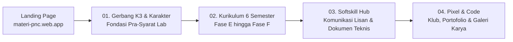
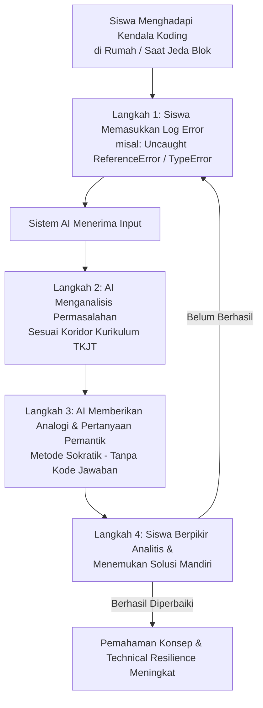
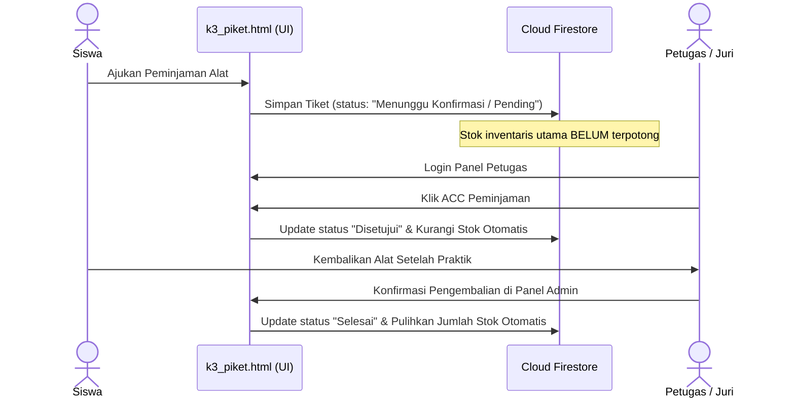

# 🌐 CLOUD-BRIDGE ECOSYSTEM (`materi-pnc.web.app`)

[-blue?style=for-the-badge)](https://materi-pnc.web.app)
[](https://materi-pnc.web.app)
[](https://materi-pnc.web.app)
[](https://materi-pnc.web.app)

### Transformasi Pembelajaran Vokasi Berbasis Ekosistem Digital Terpadu Sebagai Solusi Menjaga Konsistensi Belajar Sistem Blok

**Integrasi Kurikulum Berkelanjutan Enam Semester, Manajemen Laboratorium K3 Real-Time (`k3_piket.html`), dan Pendampingan Socratic AI Guardrails pada Kompetensi Keahlian Teknik Jaringan Komputer dan Telekomunikasi (TKJT)**

---

## 📋 Identitas Penyusun & Satuan Pendidikan

| Atribut | Keterangan |
| :--- | :--- |
| **Nama Penyusun** | **Retno Ariyanti Nurningtias, S.Pd., Gr.** |
| **Jabatan / Bidang Keahlian** | Guru Produktif TKJT (Spesialisasi Pemrograman & Cloud Computing) |
| **Satuan Pendidikan** | **SMK Ananda Mitra Industri Deltamas** |
| **Alamat Sekolah** | Kawasan Industri GIIC, Cikarang Pusat, Kabupaten Bekasi, Jawa Barat |
| **Tautan Platform Utama** | [https://materi-pnc.web.app](https://materi-pnc.web.app) |
| **Kode Otorisasi Juri / Admin** | `*******` *(Akses Panel Petugas CRUD Real-Time via Ikon **Profile**)* |

---

## 🔐 Protokol Akses Khusus Dewan Juri & Admin (*Security by Obscurity*)

> [!IMPORTANT]
> **Panduan Verifikasi Langsung untuk Dewan Juri Acer Smart School Awards 2026:**
> Untuk menguji fitur **CRUD (*Create, Read, Update, Delete*)**, dasbor pengawasan K3, manajemen inventaris, serta verifikasi alur peminjaman alat laboratorium secara *real-time*, silakan ikuti protokol akses berikut:

1. Buka tautan resmi platform [**https://materi-pnc.web.app**](https://materi-pnc.web.app) melalui perangkat *desktop* maupun ponsel pintar.
2. Klik ikon **"Profile"** (Profil Petugas) yang terletak di sudut kanan atas layar beranda.
3. Masukkan kode otorisasi keamanan / kata sandi admin resmi:
   ```text
   *******
   ```
4. **Hak Istimewa Pengujian Juri:** Kata sandi `mangats` membuka akses penuh ke panel kontrol petugas untuk menguji fitur **ACC** (menyetujui pengajuan peminjaman siswa), pemotongan dan pemulihan stok barang inventaris secara otomatis di Cloud Firestore, serta pemantauan *checklist* piket kebersihan harian **5R**.

---

## 📖 BAB I: Latar Belakang Masalah & Konsekuensi Sistem Blok

Mempertahankan daya ingat (*retensi memori*) peserta didik terhadap materi teknis yang kompleks merupakan tantangan utama bagi pendidik vokasi. Di **SMK Ananda Mitra Industri Deltamas**, tantangan ini menjadi semakin krusial karena satuan pendidikan menerapkan jadwal pembelajaran berbasis **Sistem Blok (Rotasi Mingguan)**. Dalam skema tersebut, peserta didik mempelajari kompetensi pemrograman dan jaringan secara intensif selama satu minggu penuh (pukul 07.30–15.30 WIB), kemudian beralih mengikuti mata pelajaran umum (*Normada*) maupun spesialisasi lain selama satu hingga dua minggu berikutnya.

### 📊 Perbandingan Konsistensi Belajar 21 Hari (*21-Day Coding Consistency*)

```text
CONVENTIONAL BLOCK SYSTEM (Terputus & Rentan Kurva Lupa)
[■ ■ ■ ■ ■] [□ □ □ □ □ □ □ □ □ □ □ □ □ □ □ □]
  Hari 1–5             Hari 6–21 (16-Day Learning Gap / Forgetfulness)

CLOUD-BRIDGE ECOSYSTEM - materi-pnc.web.app (Berkesinambungan 24/7)
[■ ■ ■ ■ ■ ■ ■ ■ ■ ■ ■ ■ ■ ■ ■ ■ ■ ■ ■ ■ ■]
  Hari 1–21 (Consistent Daily Habits & Continuous Spaced Practice)
```

Jeda waktu belasan hari tanpa berinteraksi langsung dengan lingkungan pengembangan maupun baris kode program menyebabkan pemahaman teknis peserta didik merosot tajam—selaras dengan teori ***Forgetting Curve*** **(Kurva Lupa)** akibat ketiadaan pengulangan berkala (*spaced repetition*).

### 🔍 Empat Kendala Empiris di Lapangan

1. **Jeda Waktu Belajar yang Terlalu Panjang (*Two-Week Learning Gap*):**
   Dengan tiga rombongan belajar yang terjadwal bergantian, setiap kelompok memperoleh giliran praktik laboratorium selama satu minggu lalu memasuki jeda pemrograman selama dua minggu. Akibatnya, otot logika (*muscle memory*) peserta didik kaku dan guru harus mengulang materi dasar dari titik nol.
2. **Beban Kognitif yang Terlalu Padat (*Cognitive Overload*):**
   Paparan materi berstandar industri dalam volume tinggi selama minggu produktif kerap mendorong peserta didik sekadar menyalin kode (*copy-paste*) demi menuntaskan tugas tanpa memahami logika di baliknya.
3. **Keterbatasan Pendampingan pada Kelas Besar (*Debugging Bottleneck*):**
   Dengan rasio **1 guru mendampingi 38 peserta didik**, siswa yang mengalami galat pemrograman (*error*) harus mengantre lama di kelas dan kehilangan arah ketika mengalami kendala saat berlatih mandiri di rumah.
4. **Beban Pengawasan K3 dan Administrasi Laboratorium:**
   Pencatatan peminjaman alat pada buku log manual serta pengawasan kebersihan ruang praktik menyita waktu efektif guru yang seharusnya difokuskan pada pembimbingan teknis.

### 💡 Solusi Jembatan Digital (*The Cloud-Bridge Solution*)

Platform [**materi-pnc.web.app**](https://materi-pnc.web.app) hadir sebagai pusat kendali pembelajaran mandiri **$24/7$** dan tata kelola laboratorium terpadu yang menghubungkan ritme belajar di sekolah dengan praktik mandiri di rumah.

---

## 🏗️ BAB II: Arsitektur Ekosistem & Alur Kerja Sistem

Platform dibangun menggunakan arsitektur web modern yang ringan, responsif lintas perangkat (*desktop* dan *mobile*), cepat diakses (*zero-lag*), serta didukung oleh infrastruktur **Google Firebase** (*Cloud Hosting* & *Cloud Firestore*).

### 1. Peta Navigasi Ekosistem (`index.html`)



### 2. Pilar Utama Pembelajaran & Inkubasi Karya

#### a. Gerbang Pembiasaan Karakter dan K3 Lab (4 Pilar Pra-Syarat)
Sebelum mengakses materi teknis, peserta didik wajib menguasai standar keselamatan kerja laboratorium:
* **Aku dan PC:** Kesehatan, kerapihan, dan sikap dasar kerja saat berada di lab komputer.
* **Sterilisasi Meja Kerja:** Aturan makan, minum, dan pengamanan kabel agar perangkat tetap aman.
* **Piket & Tanggung Jawab:** Peminjaman barang, kebersihan fasilitas, dan kepedulian pada ruang bersama.
* **Refleks Tanggap Darurat:** Deteksi dini korsleting, jalur evakuasi, dan tindakan pada bahaya fatal.

#### b. Kurikulum Berkelanjutan Enam Semester (Fase E & Fase F)
Materi kejuruan disusun secara berjenjang selama enam semester dengan dukungan **Panduan Eksekusi Praktik Lintas Perangkat** (*Workspace Laptop* menggunakan **VS Code** & *Workspace HP* menggunakan **OneCompiler**):

| Semester | Fase | Fokus Kompetensi & Capaian Pembelajaran |
| :--- | :--- | :--- |
| **Semester 1** | Fase E (Kelas X) | *Computational Thinking*, Dasar Web & Algoritma |
| **Semester 2** | Fase E (Kelas X) | Infrastruktur Linux, *Database* Relasional & IoT |
| **Semester 3** | Fase F (Kelas XI) | Administrasi Sistem, *Web Backend* & *Cloud Computing* (AWS) |
| **Semester 4** | Fase F (Kelas XI) | Rekayasa *RESTful API*, Keamanan Data & *Python Data Wrangling* |
| **Semester 5** | Fase F (Kelas XII) | *Machine Learning*, Integrasi Layanan AI & *Responsible AI* |
| **Semester 6** | Fase F (Kelas XII) | *AI Capstone*, *MLOps* & *Tech Pitching* |

#### c. Pusat Inkubasi Karya & Portofolio (*Pixel & Code*)
Seluruh luaran belajar siswa terkurasi dalam enam ruang kolaborasi: **Project** (galeri dokumen & *source code*), **Competition** (info lomba & *mentoring*), **Course** (modul praktik mandiri), **Publication** (artikel & jurnal ilmiah siswa), **Teams** (daftar kelompok kerja), serta **Galeri Karya** (dokumentasi kegiatan & sertifikat).

---

## 🤖 BAB III: Artefak AI — Socratic Debugging Assistant & AI Guardrails

Integrasi kecerdasan buatan di dalam `materi-pnc.web.app` dirancang dengan protokol pembatas ketat (**AI Guardrails**) untuk mencegah ketergantungan jawaban instan (*no spoon-feeding*). AI berperan sebagai mentor pedagogis 24 jam yang melatih nalar kritis melalui **Metode Sokratik**.

### 1. Mekanisme Kerja Socratic Debugging Assistant



### 2. Cuplikan Implementasi Skrip Integrasi (*Prompt Engineering Guardrails*)

Berikut adalah arsitektur *prompt engineering* yang tertanam pada modul asisten belajar di dalam platform untuk mengunci perilaku model AI agar tetap berada pada koridor pedagogis:

```javascript
// [REPOSITORI SOURCE CODE: Socratic AI Guardrails Implementation]
const socraticPrompt = `
PERAN: Anda adalah Guru Vokasi Pemrograman dan Jaringan TKJT.
ATURAN MUTLAK (GUARDRAILS):
1. DILARANG KERAS memberikan jawaban kode utuh (No Spoon-feeding).
2. DILARANG menyelesaikan tugas koding siswa secara langsung.
TUGAS: Analisis pesan error berikut: "${studentErrorLog}".
Berikan 1 petunjuk analogi kontekstual dan 1 pertanyaan pemantik (Metode Sokratik)
yang memaksa siswa menganalisis baris kode mereka sendiri.
`;

fetchAIResponse(socraticPrompt);
```

### 3. Etika Akademik & Perlindungan Orisinalitas Karya
* **Kontekstual & Terintegrasi:** Kotak dialog Asisten AI tertanam langsung di bagian bawah setiap modul semester sehingga siswa berkonsultasi sesuai konteks materi tanpa berpindah tab.
* **Anti-Plagiarisme:** Mekanisme pengumpulan tugas menggunakan tautan penyimpanan tertutup sehingga orisinalitas *source code* setiap siswa terlindungi.

---

## 🛠️ BAB IV: Manajemen Laboratorium & Piket K3 Real-Time (`k3_piket.html`)

Modul `k3_piket.html` menggunakan sinkronisasi basis data waktu nyata (**Cloud Firestore Real-Time Listener**) untuk mendigitalkan tata kelola bengkel/laboratorium komputer TKJT secara transparan.

### 1. Klasifikasi Inventaris Terstruktur
* **`durables` (Peralatan Tahan Lama):** Pengelolaan aset perangkat keras seperti *router*, *switch*, *access point*, tang *crimping*, dan *LAN tester*.
* **`consumables` (Bahan Habis Pakai):** Pencatatan stok material praktik seperti kabel UTP, konektor RJ-45, dan spidol papan tulis.

### 2. Alur Peminjaman, Verifikasi ACC, dan Pemulihan Stok Otomatis



### 3. Checklist Piket 5R Interaktif & Keamanan Privasi
* **Progress Bar Dinamis 5R:** Modul kebersihan harian (**Ringkas, Rapi, Resik, Rawat, Rajin**) dilengkapi indikator progres *real-time* berbasis Cloud Firestore agar tingkat kepatuhan piket terpantau transparan oleh guru dan siswa.
* **Proteksi Data Sensitif:** Sistem membatasi akses tampilan log administratif dan kontrol mutasi stok hanya bagi pemegang otorisasi sah.

---

## 📈 BAB V: Bukti Dampak & Evaluasi Empiris (Juli – November 2026)

Implementasi ekosistem `materi-pnc.web.app` di **SMK Ananda Mitra Industri Deltamas** selama periode **Juli hingga November 2026** menghasilkan lonjakan terukur pada retensi belajar mandiri dan efisiensi tata kelola kelas:

### 📊 Peningkatan Keaktifan Belajar Mandiri Siswa Selama Jeda Rotasi Blok

| Periode Pengukuran | Tingkat Keaktifan Siswa | Perubahan |
| :--- | :---: | :---: |
| **Sebelum Implementasi Platform** | **35%** | Baseline *(Aktivitas koding terhenti saat libur blok 2 minggu)* |
| **Sesudah Implementasi `materi-pnc.web.app`** | **85%** | **📈 +50% Kenaikan Signifikan** *(Rutin berlatih mandiri dari rumah)* |

### 🔄 Matriks Transformasi Sebelum vs Sesudah Implementasi

| Aspek yang Dibandingkan | Kondisi Sebelum Implementasi Web | Kondisi Sesudah Implementasi Web |
| :--- | :--- | :--- |
| **Konsistensi Kebiasaan Belajar** | Terhenti total selama dua minggu masa jeda rotasi blok di rumah. | Berlangsung rutin setiap hari melalui akses mandiri $24/7$ pada platform digital. |
| **Penanganan Galat (*Debugging*)** | Menunggu jadwal minggu produktif berikutnya atau menyalin kode teman. | Menganalisis akar masalah secara mandiri dengan panduan pertanyaan pemantik **Socratic AI**. |
| **Pengelolaan Alat & Piket Lab** | Pencatatan buku manual rentan hilang dan tidak tersinkronisasi. | Tercatat digital secara *real-time* di Firebase Firestore dengan verifikasi petugas dan *checklist* 5R. |
| **Pengarsipan Karya Siswa** | Tersebar di media penyimpanan lokal masing-masing siswa. | Terhimpun rapi dan terkurasi pada galeri portofolio digital sekolah (**Pixel & Code**). |

---

## 📚 BAB VI: Pustaka Dokumen Pendukung (*Cloud Repository*)

Sebagai wujud transparansi dan akuntabilitas karya ilmiah pendidikan, seluruh dokumen arsitektur teknis, modul cetak, dan dokumentasi antarmuka dapat diakses langsung melalui tautan berikut:

| Jenis Dokumen Pendukung | Deskripsi Teknis | Tautan Akses Aktif |
| :--- | :--- | :--- |
| **Arsitektur Database** | Struktur NoSQL Cloud Firestore (Koleksi Inventaris `durables`/`consumables` & Tiket Peminjaman) | [https://materi-pnc.web.app/database-architecture](https://materi-pnc.web.app/database-architecture) |
| **Modul Praktikum & K3** | Modul Pendamping Offline Vokasi Berkelanjutan Semester 1–6 & SOP K3 | [https://materi-pnc.web.app/modul-praktikum](https://materi-pnc.web.app/modul-praktikum) |
| **Dokumentasi UI/UX Responsif** | Tangkapan Layar Verifikasi Antarmuka Mode *Mobile* & *Desktop* | [https://materi-pnc.web.app/ui-documentation](https://materi-pnc.web.app/ui-documentation) |

---

## 🚀 BAB VII: Refleksi, Peta Jalan Pengembangan & Penutup

### 1. Catatan Evaluasi Lapangan
Pada tahap awal penerapan, peserta didik sempat mengalami masa adaptasi karena Asisten AI menolak memberikan kode jawaban instan. Melalui pendampingan literasi digital dan pembiasaan berpikir algoritmik, siswa kini justru menikmati tantangan *debugging* mandiri dan memiliki ketangguhan teknis (*technical resilience*) yang jauh lebih matang.

### 2. Peta Jalan Pengembangan (*Future Roadmap*)
* **Early Warning Learning Analytics:** Integrasi analitik otomatis untuk mendeteksi penurunan frekuensi akses siswa selama jeda blok sehingga guru dapat memberikan intervensi pendampingan lebih dini.
* **Replikasi & Open Adoption Nasional:** Membuka arsitektur ekosistem agar dapat diadopsi dan direplikasi secara gratis oleh SMK kejuruan TIK di seluruh Indonesia.

### 🏁 Simpulan
Melalui **Cloud-Bridge Ecosystem (`materi-pnc.web.app`)**, pembelajaran vokasi bertransformasi dari sekadar transfer sintaks menjadi ekosistem belajar berkelanjutan yang menjaga kesinambungan memori, kemandirian bernalar kritis beretika AI, dan budaya keselamatan kerja industri.

---

**Disusun dengan standar karya ilmiah pendidikan nasional untuk Dewan Juri Acer Smart School Awards 2026**

**Retno Ariyanti Nurningtias, S.Pd., Gr.**  
*Guru Produktif TKJT — SMK Ananda Mitra Industri Deltamas, Kabupaten Bekasi (2026)*  
🌐 [https://materi-pnc.web.app](https://materi-pnc.web.app)
