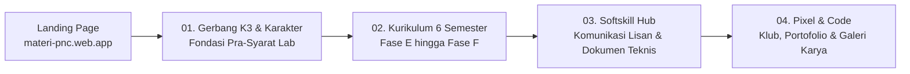
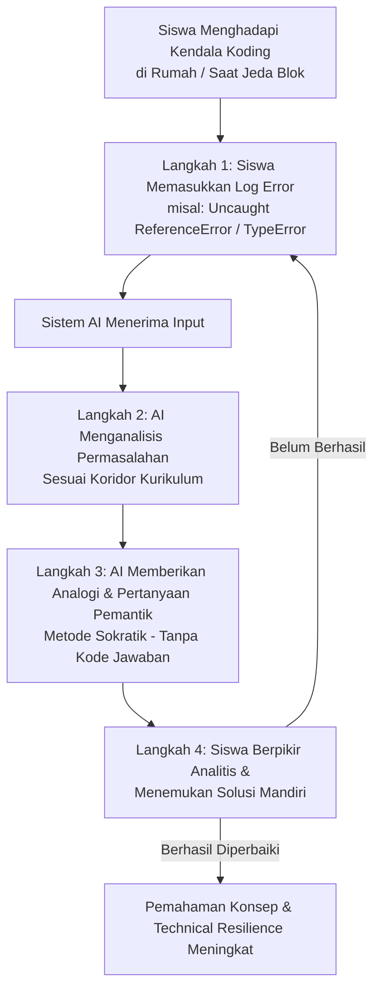

<div align="center">

# 🌐 CLOUD-BRIDGE ECOSYSTEM (`materi-pnc.web.app`)
### Transformasi Pembelajaran Vokasi Berbasis Ekosistem Digital Terpadu Sebagai Solusi Menjaga Konsistensi Belajar Sistem Blok

[](https://materi-pnc.web.app)
[-1E3A8A?style=for-the-badge)](https://materi-pnc.web.app)
[](https://materi-pnc.web.app)
[](https://materi-pnc.web.app)
[](https://materi-pnc.web.app)

**Integrasi Kurikulum Berkelanjutan Enam Semester, Manajemen Laboratorium K3 Real-Time, dan Pendampingan Socratic AI Guardrails pada Kompetensi Keahlian Teknik Komputer Jaringan dan Telekomunikasi (TKJT)**

</div>

---

## 📋 Identitas Penyusun & Satuan Pendidikan

| Atribut | Keterangan |
| :--- | :--- |
| **Nama Penyusun** | **Retno Ariyanti Nurningtias, S.Pd., Gr.** |
| **Jabatan / Bidang Keahlian** | Guru Produktif TKJT (Spesialisasi Pemrograman & Cloud Computing) |
| **Satuan Pendidikan** | **SMK Ananda Mitra Industri Deltamas** |
| **Alamat Sekolah** | Kawasan Industri GIIC, Cikarang Pusat, Kabupaten Bekasi, Jawa Barat |
| **Tautan Platform Utama** | [https://materi-pnc.web.app](https://materi-pnc.web.app) |
| **Kode Otorisasi Juri / Admin** | `mangats` *(Akses Panel Petugas CRUD Real-Time via Ikon **Profile**)* |

> [!IMPORTANT]
> **Panduan Akses Khusus Dewan Juri ASSA 2026:**
> Untuk menguji fitur manajemen inventaris, persetujuan peminjaman alat lab, dan panel admin/petugas secara *real-time* pada modul K3 & Piket (`k3_piket.html`), silakan buka **[https://materi-pnc.web.app](https://materi-pnc.web.app)**, klik ikon **Profile** di pojok kanan atas, lalu masukkan kode otorisasi keamanan: **`mangats`**.

---

## 📖 BAB I: Konsekuensi dan Tantangan Sistem Blok (Realitas Pembelajaran Kejuruan TKJT)

Mempertahankan daya ingat (*retensi memori*) peserta didik terhadap materi teknis yang kompleks merupakan salah satu tantangan utama bagi pendidik vokasi. Di **SMK Ananda Mitra Industri Deltamas**, tantangan ini menjadi semakin krusial karena satuan pendidikan menerapkan jadwal pembelajaran berbasis **Sistem Blok (Rotasi Mingguan)**. Dalam skema tersebut, peserta didik mempelajari kompetensi pemrograman dan jaringan secara intensif selama satu minggu penuh (pukul 07.30–15.30 WIB), kemudian beralih mengikuti mata pelajaran umum (*Normada*) maupun spesialisasi lain selama satu hingga dua minggu berikutnya.

### 📊 Perbandingan Konsistensi Belajar 21 Hari (*21-Day Coding Consistency*)

```text
CONVENTIONAL BLOCK SYSTEM (Terputus & Rentan Kurva Lupa)
[■ ■ ■ ■ ■] [□ □ □ □ □ □ □ □ □ □ □ □ □ □ □ □]
  Hari 1–5             Hari 6–21 (16-Day Learning Gap / Forgetfulness)

CLOUD-BRIDGE ECOSYSTEM - materi-pnc.web.app (Berkesinambungan 24/7)
[■ ■ ■ ■ ■ ■ ■ ■ ■ ■ ■ ■ ■ ■ ■ ■ ■ ■ ■ ■ ■]
  Hari 1–21 (Consistent Daily Habits & Continuous Spaced Practice)
```

Jeda waktu belasan hari tanpa berinteraksi langsung dengan lingkungan pengembangan maupun baris kode program menyebabkan pemahaman teknis peserta didik menurun drastis. Fenomena ini selaras dengan teori ***Forgetting Curve* (Kurva Lupa)** yang menegaskan bahwa tanpa pengulangan berkala (*spaced repetition*), retensi memori terhadap konsep teknis akan merosot tajam.

### 🔍 Empat Kendala Empiris di Lapangan

1. **Jeda Waktu Belajar yang Terlalu Panjang (*Two-Week Learning Gap*):**
   Dengan adanya tiga rombongan belajar yang terjadwal secara bergantian, setiap kelompok peserta didik memperoleh giliran praktik laboratorium selama satu minggu, lalu memasuki masa jeda pemrograman selama dua minggu. Padahal, kemahiran merancang perangkat lunak menuntut pembiasaan harian agar otot logika (*muscle memory*) tetap terlatih.
2. **Beban Kognitif yang Terlalu Padat (*Cognitive Overload*):**
   Selama minggu produktif, peserta didik menerima paparan materi berstandar industri dalam volume tinggi—mulai dari algoritma dasar, pengelolaan pangkalan data (*database*), hingga konfigurasi jaringan. Kondisi ini kerap mendorong peserta didik sekadar menyalin kode (*copy-paste*) demi menuntaskan tugas tanpa memahami logika di balik baris kode tersebut.
3. **Keterbatasan Pendampingan pada Kelas Besar (*Debugging Bottleneck*):**
   Dengan rasio **1 guru mendampingi 38 peserta didik** dalam satu kelas, peserta didik yang mengalami galat pemrograman (*error*) harus menunggu giliran bimbingan cukup lama. Ketika berada di rumah dan menemukan galat pada masa jeda rotasi, peserta didik kerap mengalami kebingungan hingga kehilangan motivasi belajar.
4. **Beban Pengawasan K3 dan Administrasi Laboratorium:**
   Selain melaksanakan pembelajaran, guru produktif bertanggung jawab memastikan penerapan Keselamatan dan Kesehatan Kerja (K3), kebersihan ruang praktik, serta pencatatan peminjaman peralatan laboratorium pada buku log manual yang menyita waktu efektif pembimbingan teknis.

### 💡 Solusi Jembatan Digital (*The Cloud-Bridge Solution*)
Untuk menjawab keempat tantangan tersebut secara sistemik, dikembangkan platform pembelajaran digital **[materi-pnc.web.app](https://materi-pnc.web.app)**. Platform ini berperan sebagai jembatan penghubung (*Cloud-Bridge Ecosystem*) yang memastikan peserta didik tetap dapat belajar, berlatih, dan memperoleh bimbingan terstruktur kapan pun meskipun sedang berada pada masa rotasi di rumah.

---

## 🏗️ BAB II: Arsitektur Solusi Perancangan Sistem dan Alur Kerja

Platform `materi-pnc.web.app` dibangun menggunakan arsitektur web modern yang ringan, responsif lintas perangkat (*desktop* maupun ponsel pintar), cepat diakses (*zero-lag*), serta mudah dioperasikan oleh peserta didik, guru, maupun tim penilai.

### 1. Tampilan Utama & Navigasi Ekosistem (`index.html`)
Halaman beranda menyajikan identitas ekosistem pembelajaran, profil pendidik, statistik kurikulum (**04 Modul K3**, **06 Semester**, **02 Jalur Softskill**, **05 Kelas Classroom**), serta peta navigasi terpadu:



### 2. Alur Penggunaan Platform (*User Flow*)

#### a. Gerbang Pembiasaan Karakter dan K3 Lab (4 Pilar Utama)
Sebelum memasuki materi teknis pemrograman maupun jaringan, peserta didik diwajibkan mempelajari dan menerapkan standar keselamatan kerja melalui empat modul fondasi:
* **Aku dan PC:** Kesehatan, kerapihan, dan sikap dasar kerja saat berada di lab komputer.
* **Sterilisasi Meja Kerja:** Aturan makan, minum, dan pengamanan kabel agar perangkat tetap aman.
* **Piket & Tanggung Jawab:** Peminjaman barang, kebersihan fasilitas, dan kepedulian pada ruang bersama.
* **Refleks Tanggap Darurat:** Deteksi dini korsleting, jalur evakuasi, dan tindakan pada bahaya fatal.

#### b. Kurikulum Berkelanjutan Enam Semester (Fase E & Fase F)
Materi kejuruan disusun secara berjenjang ke dalam peta kurikulum berkelanjutan selama enam semester agar penguasaan kompetensi berlangsung bertahap tanpa menimbulkan beban kognitif berlebih (*cognitive overload*):

| Semester | Fase | Fokus Kompetensi & Capaian Pembelajaran |
| :--- | :--- | :--- |
| **Semester 1** | Fase E (Kelas X) | *Computational Thinking*, Dasar Web & Algoritma |
| **Semester 2** | Fase E (Kelas X) | Infrastruktur Linux, *Database* Relasional & IoT |
| **Semester 3** | Fase F (Kelas XI) | Administrasi Sistem, *Web Backend* & *Cloud Computing* (AWS) |
| **Semester 4** | Fase F (Kelas XI) | Rekayasa *RESTful API*, Keamanan Data & *Python Data Wrangling* |
| **Semester 5** | Fase F (Kelas XII) | *Machine Learning*, Integrasi Layanan AI & *Responsible AI* |
| **Semester 6** | Fase F (Kelas XII) | *AI Capstone*, *MLOps* & *Tech Pitching* |

#### c. Ruang Kolaborasi dan Inkubasi Portofolio (*Pixel & Code*)
Seluruh proyek pemrograman, publikasi ilmiah remaja, informasi kompetisi, dan dokumentasi portofolio peserta didik dihimpun secara terpusat pada ruang kolaborasi **Pixel & Code**:
* **Project:** Galeri dokumen & *source code* karya siswa.
* **Competition:** Informasi lomba & jadwal *mentoring*.
* **Course:** Modul praktik mandiri lintas perangkat (*Workspace Laptop* via VS Code & *Workspace HP* via OneCompiler).
* **Publication:** Artikel & jurnal ilmiah siswa.
* **Teams:** Daftar kelompok kerja kolaboratif.
* **Galeri Karya:** Dokumentasi kegiatan, sertifikat, dan momen belajar.

### 3. Infrastruktur Cloud, Sinkronisasi Real-Time, dan Keamanan Data
* **Cloud Hosting & Real-Time Database:** Didukung oleh **Google Firebase** (*Cloud Hosting* dan *Cloud Firestore*) sehingga pemuatan halaman berlangsung instan dan stabil bahkan pada jaringan seluler standar.
* **Manajemen Lab & Piket Harian (`k3_piket.html`):** Menerapkan sinkronisasi basis data waktu nyata (*real-time listener*) lintas perangkat untuk pengelolaan inventaris kategori ***durables*** (alat tetap) dan ***consumables*** (bahan habis pakai), alur pengajuan peminjaman alat siswa (`status: pending`), pemotongan/pemulihan stok otomatis saat disetujui petugas menggunakan kode otorisasi **`mangats`**, serta pemantauan *checklist* kebersihan **5R**.
* **Privasi & Keamanan Data:** Membatasi tampilan data sensitif peserta didik agar tidak dapat diakses secara bebas oleh pihak yang tidak berwenang.

---

## 🤖 BAB III: Pemanfaatan Asisten Kecerdasan Buatan (AI) — Pendampingan Belajar 24 Jam Beretika Akademik

Integrasi kecerdasan buatan (*Artificial Intelligence*) di dalam platform `materi-pnc.web.app` **tidak dirancang untuk memberikan jalan pintas maupun jawaban instan** kepada peserta didik. Sebaliknya, sistem AI difungsikan sebagai mentor virtual berbasis **Metode Sokratik** yang mendampingi peserta didik selama belajar mandiri di rumah.

### 1. Alur Pendampingan Belajar Berbasis Nalar Kritis (Metode Sokratik)



### 2. Antarmuka Interaksi Asisten AI Terintegrasi
Kotak dialog percakapan **Asisten AI Belajar** tertanam langsung di bagian bawah setiap modul pembelajaran (seperti pada modul *Infrastruktur Web Dinamis & Fondasi Cloud Computing AWS*). Peserta didik dapat berkonsultasi secara kontekstual tanpa perlu berpindah aplikasi.

### 3. Batasan Etika Sistem (*AI Guardrails*) dan Perlindungan Orisinalitas Karya
* **Strict No Spoon-Feeding Guardrails:** Sistem dilengkapi aturan pembatas ketat (*AI Guardrails*) yang melarang model memberikan kode jawaban utuh secara instan, serta membatasi respons hanya pada koridor kurikulum resmi dan dokumentasi pemrograman yang valid.
* **Perlindungan Orisinalitas Karya:** Mekanisme pengumpulan tugas menggunakan tautan penyimpanan tertutup sehingga orisinalitas karya peserta didik terlindungi dari tindakan plagiarisme.

---

## 📈 BAB IV: Bukti Dampak dan Perubahan Nyata Setelah Implementasi

Implementasi ekosistem `materi-pnc.web.app` pada pembelajaran kejuruan TKJT di **SMK Ananda Mitra Industri Deltamas** selama periode **Juli hingga November 2026** menghasilkan dampak terukur terhadap kemandirian belajar peserta didik maupun efektivitas tata kelola pembelajaran:

### 📊 Lonjakan Tingkat Keaktifan Belajar Mandiri Siswa (Juli – November 2026)

| Kondisi Pengukuran | Persentase Keaktifan Belajar Mandiri | Keterangan Dampak |
| :--- | :---: | :--- |
| **Sebelum Menggunakan Platform** | **35%** | Aktivitas koding terhenti saat libur rotasi blok 2 minggu |
| **Sesudah Menggunakan `materi-pnc.web.app`** | **85%** | **Kenaikan +50%** siswa rutin mengakses modul & berlatih mandiri dari rumah |

### 🔄 Matriks Transformasi Sebelum vs Sesudah Implementasi

| Aspek yang Dibandingkan | Kondisi Sebelum Implementasi Web | Kondisi Sesudah Implementasi Web |
| :--- | :--- | :--- |
| **Konsistensi Kebiasaan Belajar** | Terhenti total selama dua minggu masa jeda rotasi blok di rumah. | Berlangsung rutin setiap hari melalui akses mandiri 24/7 pada platform digital. |
| **Penanganan Galat (*Debugging*)** | Menunggu jadwal minggu produktif berikutnya atau menyalin kode teman. | Menganalisis akar masalah secara mandiri dengan panduan pertanyaan pemantik **Socratic AI**. |
| **Pengelolaan Alat & Piket Lab** | Pencatatan buku manual rentan hilang dan tidak tersinkronisasi. | Tercatat digital secara *real-time* di Firebase Firestore dengan verifikasi petugas (`mangats`) dan *checklist* 5R. |
| **Pengarsipan Karya Siswa** | Tersebar di media penyimpanan lokal masing-masing siswa. | Terhimpun rapi dan terkurasi pada galeri portofolio digital sekolah (**Pixel & Code**). |

### 🌟 Empat Pilar Dampak Utama
1. **Peningkatan Signifikan Keaktifan dan Retensi Belajar Siswa:** Lebih dari **85%** peserta didik tetap mengakses modul dan berlatih pemrograman secara rutin dari rumah selama masa libur rotasi blok, meningkat tajam dibandingkan kondisi sebelumnya yang hanya mencapai **35%**.
2. **Penguatan Kemampuan Berpikir Kritis dan Kemandirian Pemecahan Masalah:** Peserta didik menunjukkan ketangguhan teknis (*technical resilience*) yang jauh lebih baik saat menghadapi galat pemrograman melalui panduan analitis Asisten AI.
3. **Budaya Praktik Laboratorium yang Tertib dan Berstandar K3:** Penerapan modul K3 interaktif dan *checklist* piket harian 5R berbasis *cloud* menciptakan lingkungan laboratorium yang rapi, aman, dan kondusif.
4. **Efisiensi Tata Kelola Administrasi dan Waktu Tatap Muka Guru:** Digitalisasi *logbook* inventaris serta alur peminjaman alat memangkas beban administratif manual guru sehingga waktu tatap muka di kelas fokus sepenuhnya pada pendalaman proyek industri.

---

## 🚀 BAB V: Refleksi, Evaluasi, dan Rencana Pengembangan ke Depan

### 1. Catatan Evaluasi Implementasi
Pada tahap awal penerapan, sebagian peserta didik sempat mengalami penyesuaian karena asisten AI tidak memberikan jawaban kode secara langsung. Melalui pendampingan literasi digital dan pemahaman bahwa proses bernalar jauh lebih esensial dibandingkan sekadar menyalin hasil akhir, peserta didik kini terbiasa menikmati tantangan pemecahan masalah secara mandiri.

### 2. Peta Jalan Pengembangan Sistem (*Future Roadmap*)
* **Early Warning Learning Analytics:** Penambahan fitur analitik pembelajaran otomatis untuk memetakan peserta didik yang mengalami penurunan frekuensi latihan selama masa jeda blok agar segera mendapatkan pendampingan khusus.
* **Replikasi & Open Adoption Nasional:** Memperluas keterbukaan arsitektur platform agar dapat diadopsi dan direplikasi secara gratis oleh Sekolah Menengah Kejuruan (SMK) lainnya di seluruh Indonesia.

### 🏁 Simpulan Penutup
Melalui ekosistem **[materi-pnc.web.app](https://materi-pnc.web.app)**, proses pendidikan vokasi tidak sekadar berfokus pada transfer sintaks pemrograman maupun teknik instalasi jaringan, melainkan membangun ekosistem belajar yang menjaga kesinambungan daya ingat, kemandirian bernalar, dan budaya keselamatan kerja peserta didik. Dengan perpaduan pendekatan pedagogis yang humanis, pemanfaatan kecerdasan buatan yang beretika, serta infrastruktur *cloud* yang ringan dan inklusif, inovasi ini siap melahirkan lulusan TKJT yang adaptif, berkarakter kuat, dan unggul di dunia industri.

---

<div align="center">

**Dikembangkan dengan dedikasi untuk Pendidikan Vokasi Indonesia**  
**Retno Ariyanti Nurningtias, S.Pd., Gr.** — *SMK Ananda Mitra Industri Deltamas (2026)*  
🌐 [https://materi-pnc.web.app](https://materi-pnc.web.app)

</div>
